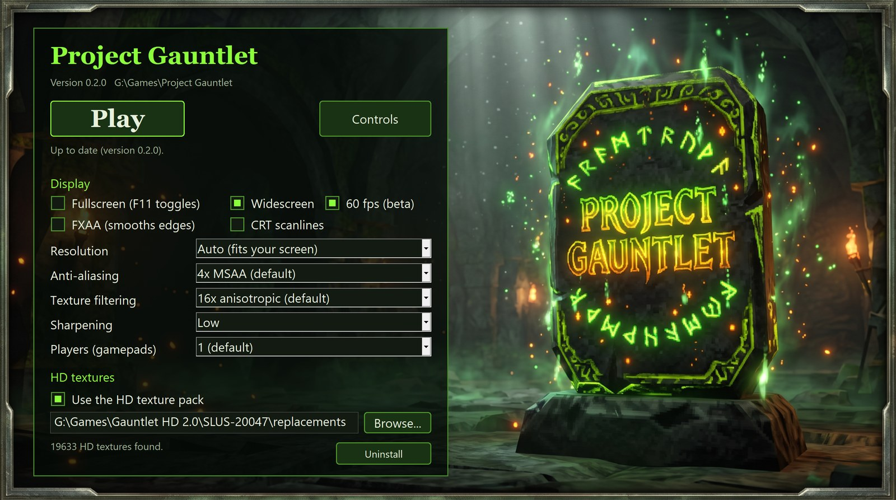
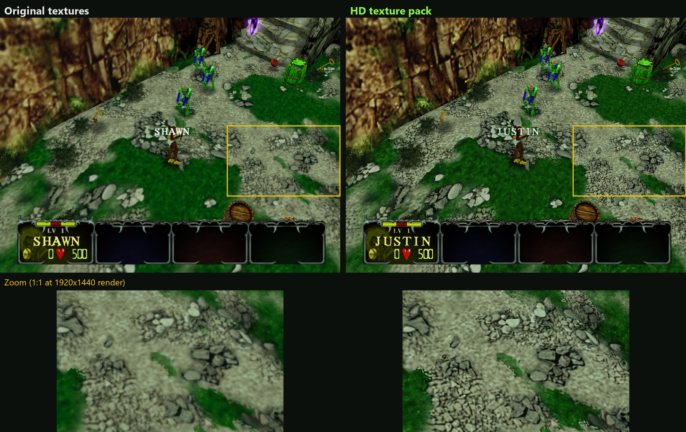
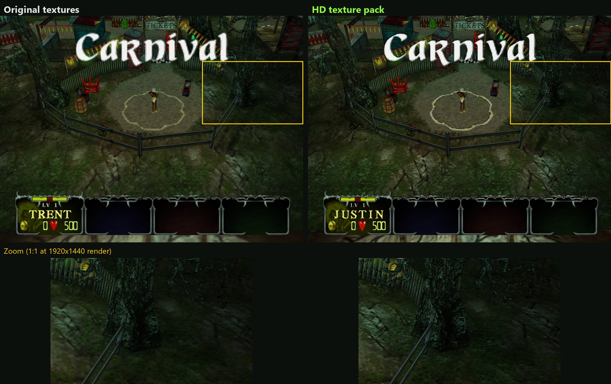
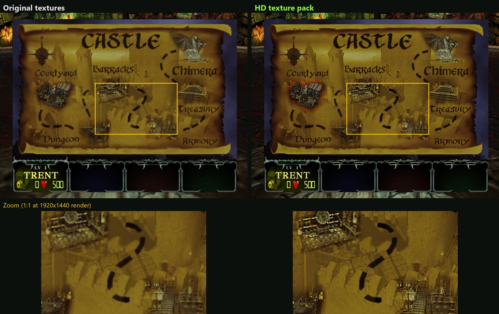
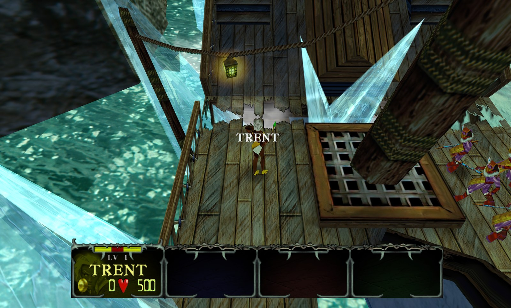
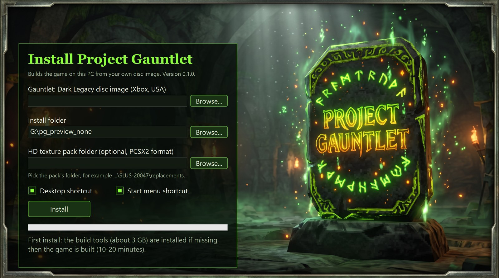
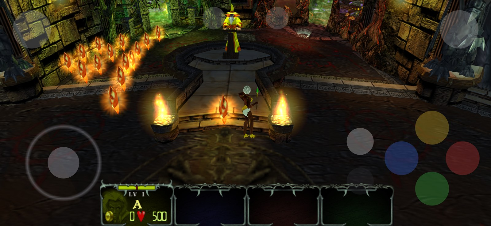

<div align="center">

# Project Gauntlet

**Gauntlet: Dark Legacy (Xbox) rebuilt as a native game for Windows, Linux and Android.**

[](https://git.8gramlabs.com/8gramlabs/Project-Gauntlet/releases/latest)
<a href="https://git.8gramlabs.com/8gramlabs/Project-Gauntlet/releases/latest"></a>

<a href="https://recomplauncher.com"><picture><source media="(prefers-color-scheme: dark)" srcset="https://recomplauncher.com/assets/press/launcher/badge-light.svg"></picture></a>

[](https://drive.google.com/file/d/1QN0gNCpc3p0pgFx2zmSlYOAePSD4DEMY/view?usp=drive_link)

[](#install)
[](#linux)
[](#android)
[](https://git.8gramlabs.com/8gramlabs/Project-Gauntlet/releases/latest)
[](#features)
[](#features)
[](#features)

A static recompilation by 8gram Labs: the original x86 game code is translated to C and compiled natively for
64-bit Windows (Direct3D 11), Linux (Vulkan through DXVK) and Android phones (arm64, Vulkan), with HD texture packs,
widescreen, a locked 60 fps, MSAA, support for almost any controller and a launcher.



</div>

> No game code or data ships with this project. The installer builds the game **on your PC from your own
> Gauntlet: Dark Legacy (Xbox, USA) disc image**.

> [!NOTE]
> **Antivirus and "Windows protected your PC" warnings.** `ProjectGauntlet-Setup.exe` is not code-signed (signing
> certificates cost money), so Windows SmartScreen and some antivirus programs may warn about it or flag it on
> heuristics. The setup also compiles a brand-new `gauntlet.exe` on your PC (and, if you use it, a brand-new Android
> APK) that no antivirus has seen before, which some engines dislike. These are false positives: nothing in it is
> malicious.
>
> - **SmartScreen ("Windows protected your PC"):** click **More info**, then **Run anyway**.
> - **Your antivirus quarantines `gauntlet.exe` after the build:** restore it and allow the install folder, then
>   run the setup again (it updates in about a minute). Don't turn your antivirus off completely.
> - Only download from the official [Forge](https://git.8gramlabs.com/8gramlabs/Project-Gauntlet/releases) or
>   [GitLab](https://gitlab.com/octagram-labs-group/Project-Gauntlet/-/releases) release pages. All of the source
>   code is right here, so you're always welcome to check what it does or [build it yourself](#building-from-source-developers).

## Features

- **Native builds, no emulator.** Every function of `Default.xbe` is lifted to C and compiled for the machine it
  runs on: 64-bit Windows, Linux (x86-64) and Android (arm64).
- **Linux.** A native build with the same renderer on Vulkan (DXVK), SDL3 for window, sound and controllers, and a
  `setup.sh` installer with menu entry, updates and uninstall.
- **Android.** Your PC turns your installed game into an APK for your phone or tablet. It has on-screen touch
  controls and supports Bluetooth and USB controllers. See [Android](#android).
- **High resolution.** The game renders at a multiple of 640x480, sized to your monitor by default (up to 6x,
  3840x2880).
- **Widescreen (hor+).** It fills 16:9, 21:9 and wider screens with more of the level. The HUD stays centered and
  the menus are pillarboxed.
- **HD texture packs (optional).** It loads PCSX2-format replacement packs made for the PS2 version, such as the
  community *Gauntlet Dark Legacy HD 2.0* pack ([download](https://drive.google.com/file/d/1QN0gNCpc3p0pgFx2zmSlYOAePSD4DEMY/view?usp=drive_link)). The PS2 texture hashes are
  rebuilt from the Xbox data, so the pack works unchanged.
- **60 fps.** The Xbox game caps itself at 30 fps but times its game logic from a 60 Hz clock. The port paces
  frames on that clock, so it runs at a locked 60 fps by default without speeding the game up (30 fps is a launcher
  option).
- **Anti-aliasing and filtering.** Up to 8x MSAA, FXAA and 16x anisotropic filtering.
- **Post-processing.** Optional sharpening (good with HD textures) and a CRT scanline look.
- **Softer hit flash.** Characters hit in combat get a translucent white tint instead of a solid white
  silhouette (Soft by default; Full shows the original look, Off removes it).
- **Borderless fullscreen.** Toggle with F11 or Alt+Enter.
- **Local multiplayer for up to 4 players** on almost any controller: Xbox, PlayStation 3/4/5, Switch Pro and
  Joy-Con, Steam Controller, 8BitDo and other USB or Bluetooth pads (SDL3). **Online netplay is coming soon**; for
  now, multiplayer is local (same screen).
- **Remappable controls.** Rebind keyboard keys and gamepad buttons in the launcher.
- **Launcher.** Play, check for updates, change display and control settings, pick an HD pack, uninstall.
- **Auto-update.** A new release is downloaded and the game is rebuilt from your installed data, without the disc
  (Windows and Linux).

## HD textures: before and after

Left: the original textures. Right: the HD pack. The yellow box on each full view is shown at 1:1 below it.


<details>
<summary><b>More comparisons</b> (forest, carnival, spire, town, combat, realm map)</summary>







</details>

## Widescreen



## Install

### Windows

1. Download `ProjectGauntlet-Setup-<version>.exe` from the
   [releases](https://git.8gramlabs.com/8gramlabs/Project-Gauntlet/releases) page.
2. Run the setup. Choose your disc image (`.iso` / `.xiso`), an install folder and, optionally, an HD texture pack
   folder.
3. Click **Install**. On first install the setup downloads the compiler (llvm-mingw, about 190 MB) into the install
   folder. No administrator rights are needed. It then extracts, translates and compiles the game. Expect a few minutes
   the first time and about 1 minute for updates.
4. Start the game with the **Project Gauntlet** shortcut. It opens the launcher.



Without an installer, or for RecompLauncher: `ProjectGauntlet-<version>-Windows-x64.zip` from the same page.

### Linux

1. Download `ProjectGauntlet-Linux-x64-<version>.tar.gz` from the
   [releases](https://git.8gramlabs.com/8gramlabs/Project-Gauntlet/releases) page and unpack it.
2. You need glibc 2.38 or newer (Ubuntu 24.04, Debian 13, Fedora 39, Linux Mint 22, Arch, SteamOS 3.6 or newer),
   Python 3.9 or newer, clang or gcc, and a Vulkan driver:
   - Ubuntu/Debian: `sudo apt install python3 clang libvulkan1 mesa-vulkan-drivers`
   - Fedora: `sudo dnf install python3 clang vulkan-loader mesa-vulkan-drivers`
   - Arch: `sudo pacman -S python clang vulkan-icd-loader` (plus your GPU's Vulkan driver)
3. Run `./setup.sh --iso "<your disc image>"` (add `--hd <pack folder>` for the HD textures). Double-clicking
   `setup.sh` asks for the image with a dialog. The build takes a few minutes.
4. Start **Project Gauntlet** from your applications menu. Settings live in `settings.ini` in the install folder
   (default `~/.local/share/project-gauntlet`). See `README-Linux.txt` in the package for the details.

### HD texture pack (optional)

The game looks and plays fine without it. To use HD textures, download the community *Gauntlet Dark Legacy HD 2.0*
pack ([Google Drive](https://drive.google.com/file/d/1QN0gNCpc3p0pgFx2zmSlYOAePSD4DEMY/view?usp=drive_link)) or any other PCSX2 replacement pack for the PS2 version (serial
`SLUS-20047`). Unpack it, then pick its folder, for example `...\SLUS-20047\replacements`, in the setup or the
launcher (Linux: `--hd <folder>` or `GT_HDTEX` in `settings.ini`). The pack is used where it is and is not copied.
Uninstalling never touches it.

### Android



The game also runs on Android phones and tablets (arm64, Android 13 or newer, Vulkan). The APK is built on your PC
from your installed game, so it holds only your own copy:

1. Install the game on your PC first (Windows setup above, or `setup.sh` on Linux).
2. In the launcher, click **Android...** (Linux: `./setup.sh --android`). The first build downloads Google's Android
   NDK (about 700 MB) and takes 10 to 20 minutes. Later builds take a few minutes.
3. Copy `ProjectGauntlet-<version>-Android.apk` (about 1 GB) from the install folder to the phone and open it there.
   Android asks you to allow installs from that app once.
4. The first start unpacks the game files, which takes about a minute.

#### How the Android build works

There is no APK to download, on purpose: an APK of the game would contain the game. Your PC makes it instead,
from the copy you installed:

1. **Your PC already has the game.** The Windows or Linux install translated your disc's game code to C and
   compiled it for your PC.
2. **Android... compiles that same code for phones.** The launcher downloads Google's Android NDK (the official
   compiler for Android) once into the install folder, and compiles the translated game code for arm64 phones.
3. **It fills in an empty app.** Each release ships an Android app "shell" (`android/template.apk`) with the
   runtime pieces only: SDL3, the Vulkan graphics layer (DXVK and vkd3d) and the Java start-up code. It contains no
   game code and no game files. Your PC adds the compiled game and your game files to it.
4. **It signs the app with your own key.** Android only installs signed apps, so your PC makes a signing key the
   first time (`android\signing-key.json`) and signs every build with it.
5. **You install it.** The finished `ProjectGauntlet-<version>-Android.apk` stays in your install folder. Copy it to
   your phone and open it. On the first start the app unpacks the game files into its own storage.

Nothing leaves your PC except the APK you copy to your own phone. Rebuild the APK after updating the PC install to
get the new version on your phone.

On-screen controls show until a controller is connected: a stick that appears where your left thumb lands,
A/B/X/Y, White/Black, the triggers in the top corners and BACK/START at the top. The game runs at 60 fps on recent
phones (tested on a Galaxy S26 Ultra); very busy scenes can dip, and `GT_SCALE=2` in `settings.ini` in the app's
folder (`Android/data/com.eightgramlabs.gauntlet/files`) lowers the load. Each PC signs its APKs with its own key, stored in
`android\signing-key.json` in the install folder. Keep that file: a new build only installs over the old one when it
is signed with the same key.

## Controls

| Xbox pad | Keyboard |
|---|---|
| D-pad | Arrow keys |
| Left stick | W A S D |
| A / B / X / Y | Z / X / C / V |
| Black / White | F / G |
| LT / RT | Q / E |
| START / BACK | Enter / Backspace |
| | F11 or Alt+Enter: fullscreen |

Controllers work too: Xbox, PlayStation, Switch Pro, 8BitDo and most other pads (buttons go by position, so the bottom face button is A). A pad that is not recognised gets a generic layout; its SDL mapping line can go in `controllers.txt` in the game folder. Set the number of players and remap keys and buttons in the launcher (**Controls**).


## Status

**The game is playable from start to finish.** Every realm, boss and secret level has been played through on the
recompiled build. Most of these runs used scripted input with test cheats (invincibility, low boss health) to get
through quickly.

| Area | State |
|---|---|
| Boot, intro movies, title, character select | Working (all 8 starting heroes) |
| Tower hub, saves, loading, level progression | Working |
| All eight realms and their bosses | Working (including the Lich, the Yeti and the Plague Fiend) |
| Locked worlds and the final boss | Working: Skorne, Garm and the ending movie |
| Secret levels S1 to S9 | All load and return to their parent level |
| Local multiplayer (up to 4 pads) | Working |
| Online netplay | Coming soon |
| Linux | Working: install, update, uninstall, play (Ubuntu 24.04, Debian 13) |
| Android | Working: built from your PC install, touch controls, controllers, 60 fps on a Galaxy S26 Ultra |
| Sound, music, movies | Working |
| HD textures, widescreen, MSAA, post-processing | Working |
| 60 fps (default) | Locked 60.0 fps on PC and phone; enemy attack timing, effects and walk speed match 30 fps |
| Installer, launcher, updates, uninstall | Fresh install, update and uninstall tested on Windows and Linux |

Known gaps:
- About 8% of the textures seen in a level stay original: the pack has no file for them (Xbox-only art such as
  the A/B button icons, and some effect animations).
- At 60 fps loading screens finish sooner (the loader works per frame). Report anything that runs at the wrong
  speed; the launcher's 60 fps box (settings.ini `GT_FPS=30`) switches back to the original 30.
- High refresh rates (120/144 Hz) are not supported: much of the game logic counts whole 60 Hz ticks.
- Android: very busy scenes can drop below 60 fps on phones (many small draw calls); only tested on a Snapdragon
  (Adreno) phone so far.
- Real PlayStation and Xbox controllers have only been tested through simulated pads so far.
- Not yet tested on a clean PC (Windows Sandbox).

## How it works

- `recomp/lift.py` translates the x86 code of `Default.xbe` to C: about 228k instructions, with the x87 FPU
  modeled. A differential oracle compares lifted functions with an emulator run on the original bytes.
- `runtime/` holds the Xbox kernel, file system and threads, DirectSound mixed in software, and a Direct3D 11
  translation of the NV2A push buffer.
- `runtime/src/hdtex.c` matches textures against PCSX2 packs. It rebuilds the PS2 TEX0 hash by laying the indices
  out as 256-byte GS memory blocks, and the CLUT hash from the palette. When a pack has several palette variants of
  one texture, it picks the closest by image comparison. Loaded HD textures stay within a VRAM budget.
- `installer/` holds the setup and launcher (one Win32 exe), and `tools/gt_build.py` runs the on-PC build.
- Linux and Android use the same runtime and renderer through a small Win32 compatibility layer
  (`runtime/src/linux/`), DXVK Native (Direct3D 11 on Vulkan), vkd3d-shader and SDL3. `tools/gt_android.py` builds
  the APK on the player's PC: it compiles the translated code with the Android NDK, adds it and the player's game
  files to a template APK that holds no game code, and signs it with a key made on that PC.

See [docs/design.md](docs/design.md) and [docs/installer.md](docs/installer.md) for the details.

## Building from source (developers)

Requirements: Python 3 with `capstone` and your disc image. The compiler (llvm-mingw) is downloaded into the build
folder.

```bat
python -I tools\gt_build.py --root <build folder> --iso "<path to your disc image>"
<build folder>\gauntlet.exe
```

This is the same build the installer runs: extract, check the disc, translate, compile and link.
`installer\build.bat` packages `dist\ProjectGauntlet-Setup-<version>.exe` and the portable zip (this one needs Visual
Studio 2022 Build Tools and LLVM).

## Legal

Gauntlet: Dark Legacy is a trademark of its owners. This project is not affiliated with or endorsed by them. It
contains no game code, data or assets. You need your own copy of the game. HD texture packs are third-party
community work and are not part of this project; the link above points to a community upload.
