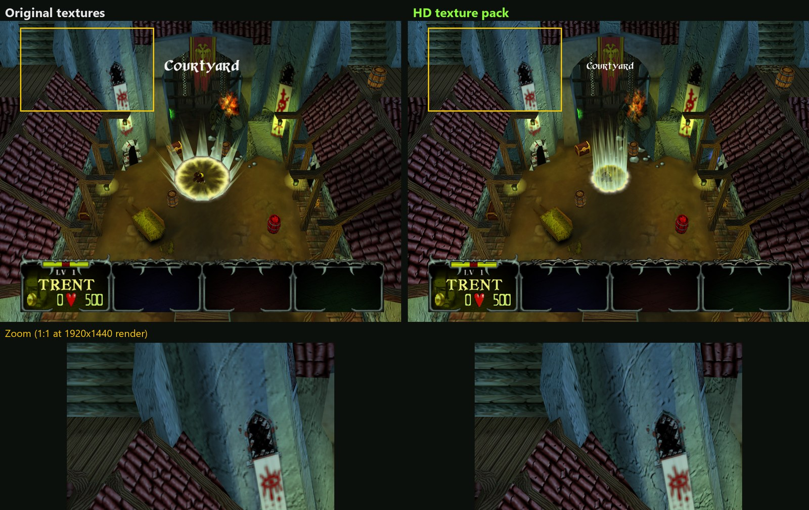
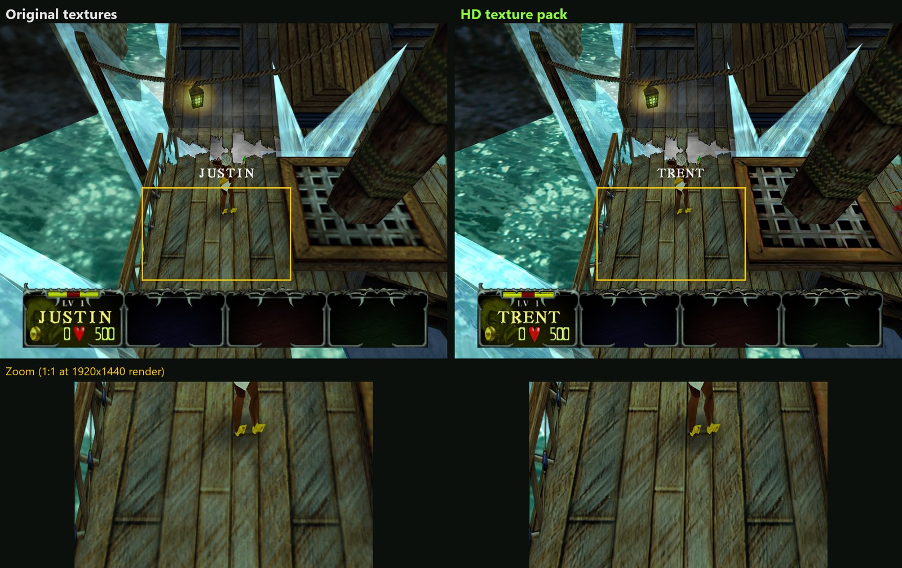
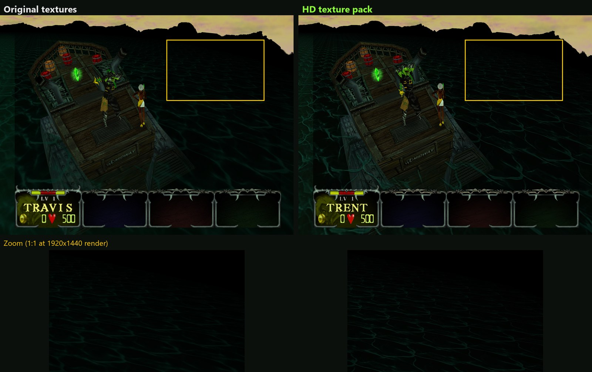
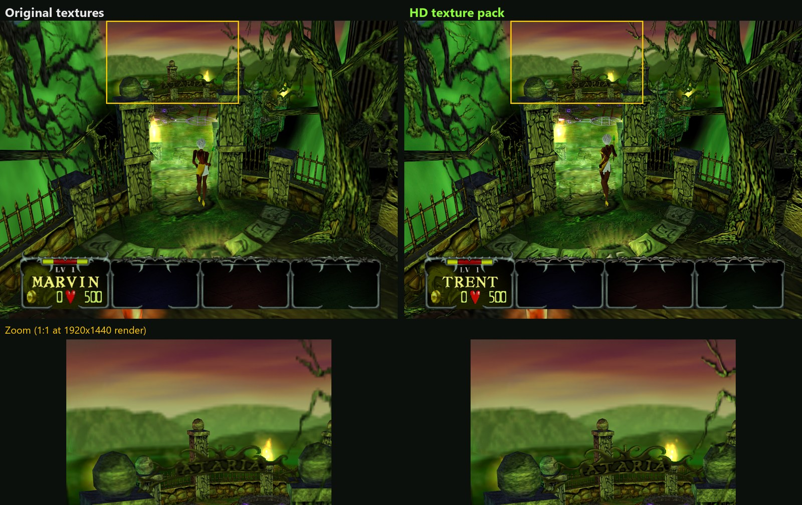
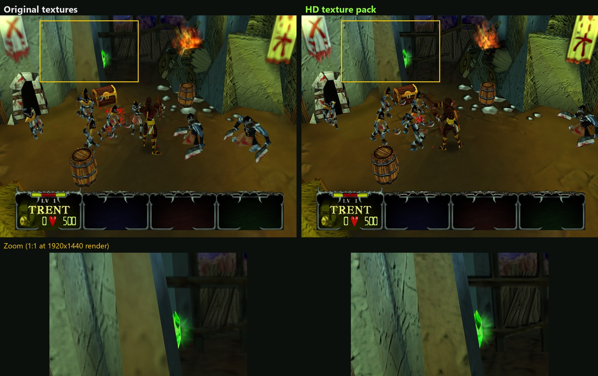
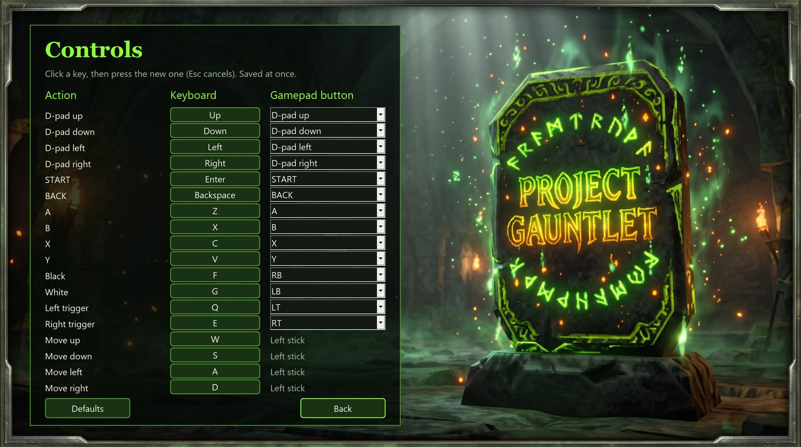

<div align="center">

# Project Gauntlet

**Gauntlet: Dark Legacy (Xbox) rebuilt as a native Windows game.**

A static recompilation by 8gram Labs: the original x86 game code is translated to C and compiled for 64-bit
Windows, with a Direct3D 11 renderer, HD texture packs, widescreen, 60 fps, MSAA and a launcher.


</div>

> No game code or data ships with this project. The installer builds the game **on your PC from your own
> Gauntlet: Dark Legacy (Xbox, USA) disc image**.

## Features

- **Native 64-bit Windows build.** No emulator: every function of `Default.xbe` is lifted to C and compiled with
  clang-cl.
- **High resolution.** The game renders at a multiple of 640x480, sized to your monitor by default (up to 6x,
  3840x2880).
- **Widescreen (hor+).** It fills 16:9, 21:9 and wider screens with more of the level. The HUD stays centered and
  the menus are pillarboxed.
- **HD texture packs.** It loads PCSX2-format replacement packs made for the PS2 version, such as the community
  *Gauntlet Dark Legacy HD 2.0* pack. The PS2 texture hashes are rebuilt from the Xbox data, so the pack works
  unchanged.
- **60 fps (beta).** The Xbox game caps itself at 30 fps but times its game logic from the clock, so the cap can
  be lifted without speeding the game up.
- **Anti-aliasing and filtering.** Up to 8x MSAA, FXAA and 16x anisotropic filtering.
- **Post-processing.** Optional sharpening (good with HD textures) and a CRT scanline look.
- **Softer hit flash.** Characters hit in combat get a translucent white tint instead of a solid white
  silhouette (Soft by default; Full shows the original look, Off removes it).
- **Borderless fullscreen.** Toggle with F11 or Alt+Enter.
- **Up to 4 players** on XInput gamepads.
- **Remappable controls.** Rebind keyboard keys and gamepad buttons in the launcher.
- **Launcher.** Play, check for updates, change display and control settings, pick an HD pack, uninstall.
- **Auto-update.** A new release is downloaded and the game is rebuilt from your installed data, without the disc.

## HD textures: before and after

Left: the original textures. Right: the HD pack. The yellow box on each full view is shown at 1:1 below it.




<details>
<summary><b>More comparisons</b> (forest, carnival, spire, town, combat, realm map)</summary>







</details>

## Widescreen


## Install

1. Download `ProjectGauntlet-Setup-<version>.exe` from the
   [releases](https://git.8gramlabs.com/8gramlabs/Project-Gauntlet/releases) page.
2. Run the setup. Choose your disc image (`.iso` / `.xiso`), an install folder and, optionally, an HD texture pack
   folder.
3. Click **Install**. On first install the setup downloads the build tools if they are missing: Visual Studio
   Build Tools (C++) and LLVM, about 3 GB from Microsoft and llvm.org. It then extracts, translates and compiles the
   game. Expect 10 to 20 minutes the first time and about 1 minute for updates.
4. Start the game with the **Project Gauntlet** shortcut. It opens the launcher.


### HD texture pack

Get a PCSX2 replacement pack for the PS2 version (serial `SLUS-20047`). Then pick its folder, for example
`...\SLUS-20047\replacements`, in the setup or the launcher. The pack is used where it is and is not copied.
Uninstalling never touches it.

## Controls

| Xbox pad | Keyboard |
|---|---|
| D-pad | Arrow keys |
| Left stick | W A S D |
| A / B / X / Y | Z / X / C / V |
| Black / White | F / G |
| LT / RT | Q / E |
| START / BACK | Enter / Backspace |
| | F11 or Alt+Enter: fullscreen |

XInput gamepads work too. Set the number of players and remap keys and buttons in the launcher (**Controls**).



## Status

**The game is playable from start to finish.** Every realm, boss and secret level has been played through on the
recompiled build. Most of these runs used scripted input with test cheats (invincibility, low boss health) to get
through quickly.

| Area | State |
|---|---|
| Boot, intro movies, title, character select | Working (all 8 starting heroes) |
| Tower hub, saves, loading, level progression | Working |
| All eight realms and their bosses | Working (including the Lich, the Yeti and the Plague Fiend) |
| Locked worlds and the final boss | Working: Skorne, Garm and the ending movie |
| Secret levels S1 to S9 | All load and return to their parent level |
| Multiplayer (up to 4 pads) | Working |
| Sound, music, movies | Working |
| HD textures, widescreen, MSAA, post-processing | Working |
| 60 fps (beta) | Three realms played through to their bosses at 58-59 fps; game speed unchanged |
| Installer, launcher, updates, uninstall | Fresh install, update and uninstall tested; the in-launcher update download waits for the first release |

Known gaps:
- About 8% of the textures seen in a level stay original: the pack has no file for them (Xbox-only art such as
  the A/B button icons, and some effect animations).
- With 60 fps on, loading screens finish about 2 seconds sooner. Report anything else that runs at the wrong speed.
- Not yet tested on a clean PC (Windows Sandbox) or with other characters past the first level at 60 fps.

## How it works

- `recomp/lift.py` translates the x86 code of `Default.xbe` to C: about 228k instructions, with the x87 FPU
  modeled. A differential oracle compares lifted functions with an emulator run on the original bytes.
- `runtime/` holds the Xbox kernel, file system and threads, DirectSound mixed in software, and a Direct3D 11
  translation of the NV2A push buffer.
- `runtime/src/hdtex.c` matches textures against PCSX2 packs. It rebuilds the PS2 TEX0 hash by laying the indices
  out as 256-byte GS memory blocks, and the CLUT hash from the palette. When a pack has several palette variants of
  one texture, it picks the closest by image comparison. Loaded HD textures stay within a VRAM budget.
- `installer/` holds the setup and launcher (one Win32 exe), and `tools/gt_build.py` runs the on-PC build.

See [docs/design.md](docs/design.md) and [docs/installer.md](docs/installer.md) for the details.

## Building from source (developers)

Requirements: Visual Studio 2022 Build Tools (C++), LLVM (clang-cl, lld-link), Python 3 with `capstone`, and your
disc image.

```bat
python -I tools\gt_build.py --root <build folder> --iso "<path to your disc image>"
<build folder>\gauntlet.exe
```

This is the same build the installer runs: extract, check the disc, translate, compile and link.
`installer\build.bat` packages `dist\ProjectGauntlet-Setup-<version>.exe`.

## Legal

Gauntlet: Dark Legacy is a trademark of its owners. This project is not affiliated with or endorsed by them. It
contains no game code, data or assets. You need your own copy of the game. HD texture packs are third-party
community work and are not distributed here.
